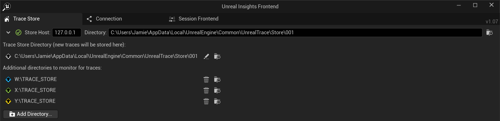

# RealtimeLabICVFX
ICVFX configuration plugin for the CoSTAR Realtime Lab.

## Dependencies
Engine plugins:
- LiveLink
- LiveLinkHub
- nDisplay
- [Optional] Stage Monitor

Third-party plugins:
- MoSysVPFree ([Download on Fab](https://www.fab.com/listings/4b0ddb44-8d3d-4eb4-8009-9da580f54b38))
- CanonLiveLinkPlugin ([Download from Canon](https://www.canon-europe.com/support/consumer/products/camcorders/cinema-eos/eos-c400.html?type=download&detailId=tcm:13-2389615&os=windows%2011&language=en&productTcmUri=tcm:13-2387148))
- [Optional] NVIDIA DLSS ([Download from NVIDIA](https://developer.nvidia.com/rtx/dlss?sortBy=developer_learning_library%2Fsort%2Ffeatured%3Adesc%2Ctitle%3Aasc#section-getting-started))

Switchboard Plugins (required if using SwitchboardConfigGenerator):
- [ExeLauncher](https://github.com/jambuttenshaw/exelauncher)
- [nDisplayTrace](https://github.com/jambuttenshaw/ndisplaytrace)

See [Installing Switchboard Plugins](Docs/InstallingSwitchboardPlugins.md) for how to install Switchboard plugins.
## Quick Start
These are step-by-step instructions for launching your project in the Realtime Lab for the first time.
> [!IMPORTANT]
> Your project must be on DEATH's `D:` drive for it to launch correctly.
### 1. Remove Sublevels
For nDisplay stability, all actors should be moved from sublevels into the persistent level. 
This can be done as follows:
1. **Make a backup of the original level as these steps cannot be undone.**
2. Open Levels window
3. Right click on the first sublevel below the persistent level.
4. Click 'Select Actors'
5. Right click on the persistent level.
6. Click 'Move Selected Actors to Level'
7. Delete the sublevel by selecting it and pressing the Delete key.
8. Repeat steps 3-7 until all sublevels have been removed.
### 2. Set up nDisplay
- Drag `nDisplaySublevel` (found in `Plugins > RealtimeLabICVFX > Levels`) into the desired level.
- Break sublevel:
    - Right-click on `nDisplaySublevel` in the outliner.
    - Go to `Level > Break` and select `Break Level Instance(s)`.
- Set CineCamera association:
    - Click on `nDisplayRealtimeLab` in the outliner.
    - Go to the `ICVFXCamera` component in the details panel.
    - In the `Camera` category, find `Cine Camera Actor` property and select `CanonC400` from the dropdown.
- Position `nDisplayRealtimeLab` to desired location in the level.
### 3. Setting up Switchboard with SwitchboardConfigGenerator
- Run `SwitchboardConfigGenerator.exe`. It is located in the root directory of the **RealtimeLabICVFX** plugin.
- Input the path to the engine directory when prompted. By default, Unreal Engine is installed to `C:/Program Files/Epic Games/UE_5.x/Engine` but the actual location will depend on your engine version and install location.
- `SwitchboardConfigGenerator` should have created `<project name>_SwitchboardConfig.json` next to your `.uproject` file.
- Launch Switchboard.
- Go to `Configs > Load Config > Browse...` and browse to `<project name>_SwitchboardConfig.json`. Open the generated config.
- Select the level containing your nDisplay config from the `Level:` dropdown. You may need to click the refresh button to the right of the dropdown if your level is not shown in the dropdown.
### 4. Launching with Switchboard
Pre-launch checklist:
- All render nodes and LED processors are switched on and genlocked / framelocked. See [Framelock Verifcation Guide](Docs/FramelockVerification.md).
- No instances of Unreal are currently running.
- Switchboard Listener is running on all control and render nodes.
- You have built the project since any previous source changes. Switchboard is not configured to build your project before launching.

Launch Sequence:
- Connect to all Switchboard Listener instances for each device in Switchboard.
- Launch Switchboard with the generated configuration for your project.
- Run the `Sync` device to launch a FreeFileSync batch to synchronize the project between the control machine and all render nodes. Wait until synchronization completes.
- Click plus button in right hand side of multi-user session dialog to increment session ID. **You MUST do this between every launch.**
- Launch the `LiveLinkHub` device first.
- Launch all nDisplay and editor devices in Switchboard.

## Customizing Switchboard Config via `StudioProperties.json`
`SwitchboardConfigGenerator` will create a `StudioProperties.json` within the plugin root directory. This can be modified to customize the Switchboard configuration that is generated (e.g. to customize CVars for specific render nodes on a per-project basis).

For more information on configuration options see the [Studio Properties Reference](Docs/StudioPropertiesReference.md).

After modifying `StudioProperties.json`, run `SwitchboardConfigGenerator.exe` again to update the configuration. This will overwrite any additional configuration you have done within Switchboard, so ideally all additional config should be performed within `StudioProperties.json`.

## Troubleshooting
- It is sometimes recommended to run Switchboard Listener as Administrator on all render nodes.
- Remember to increment the multi-user session ID between launches.
- Delete `StudioProperties.json` and `<project name>_SwitchboardConfig.json` and regenerate via `SwitchboardConfigGenerator.exe` to restore Switchboard config to default.

### LiveLink
You can check if LiveLink and LiveLinkHub are working correctly by:

`TODO: Checking LiveLink status`

If there are LiveLink issues:
- Check Camera network settings. See [CanonLiveLinkPlugin documentation](Docs/CanonLiveLinkPluginDocs.pdf) for how to set up the Canon for LiveLink.

For information:
- All LiveLinkHub plugins are installed as **project plugins** in the LiveLinkHub project (`<Engine Directory>/Source/Programs/LiveLinkHub/`).
- By default, LiveLinkHub will load the config file stored in `<Engine Directory>/Source/Programs/LiveLinkHub/Content`. If there are any issues with this config, an additional copy is inside this plugin in `Content/LiveLink/LiveLinkHubConfig_RealtimeLab.json`.

## Profiling
The nDisplayTrace device can be used to profile all render nodes in the nDisplay config simultaneously. The trace files are given useful filenames and stored on the render nodes, but can be easily accessed remotely from a control machine.

To start and stop profiling, use the "Start / Stop" profiling button on the nDispalyTrce device. **The nDisplay cluster must be running to begin profiling**.

If you have configured a trace store directory in `StudioProperties.json` then all trace files will be saved there (locally on each render node). If there is no trace store directory set, then trace files will be stored in the default directory within each project (`<Project Root>/Saved/Profiling/`).

The Insights frontend can be easily configured to automatically detect new trace files on the render node. Simply add the trace store directory on each render node into the Insights directory watchlist. For example, if I had the trace store set to `D:/TRACE_STORE` in `StudioProperties.json`, I can add the following additional directories for Insights to monitor:

## TODO
- LED wall meshes: Consistent naming between static mesh assets, static mesh components in the nDisplay config, and viewports in the nDisplay cluster. (E.g., wild wall meshes are labelled left vs right, static mesh components are enumerated - which associates with which?).
